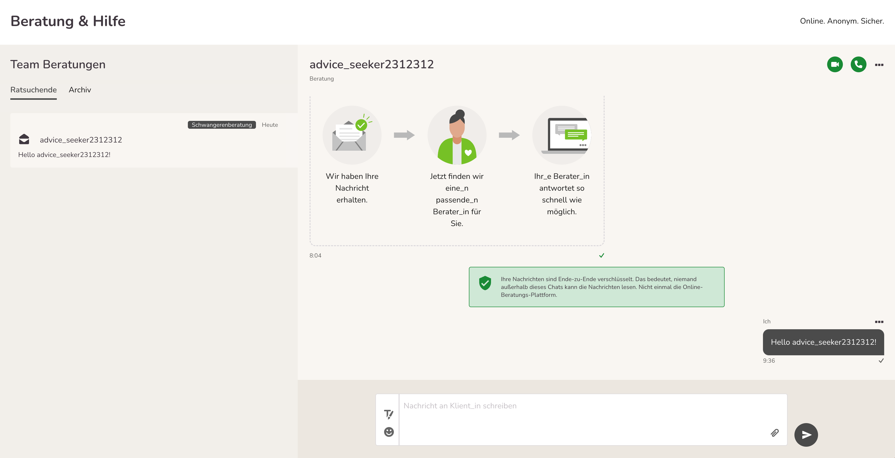

Die Teamberatung ist eine Zusatzfunktion, die extra hinzugefügt werden muss. Wenn sie vorhanden ist, funktioniert sie folgendermaßen:

Alle Beratende können hier sämtliche Nachrichten der anderen Beratenden einsehen und an Konversationen mit deren Ratsuchenden teilnehmen. Nur die eigenen Nachrichten, die in „Meine Nachrichten“ sind, befinden sich nicht im Teamberatungsbereich sondern weiter in „Meine Nachrichten“.
